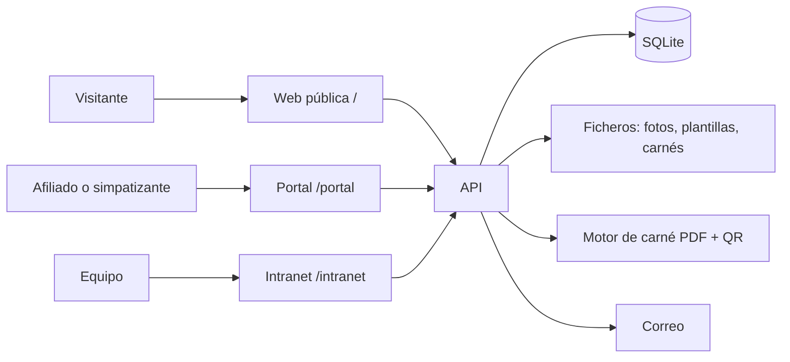

# 01 · Arquitectura

## Visión general



Una sola aplicación web con tres zonas y una API que las sirve a todas. Es la misma idea que IDENTIA.

| Zona | Ruta | Quién entra | Para qué |
|---|---|---|---|
| Web pública | `/` | Cualquiera | Información del movimiento, afiliarse, simpatizante, novedades |
| Portal | `/portal` | Afiliados y simpatizantes | Ficha, carné, encuestas, solicitudes, historial |
| Intranet | `/intranet` | Equipo, con rol | Gestión de personas, solicitudes, encuestas, plantillas, usuarios y **verificación de carnés** |

> Los nombres `/portal` e `/intranet` son una propuesta. Ver [decisiones pendientes](09-decisiones-pendientes.md).

## Stack (referencia: IDENTIA)

- **Web**: React + TypeScript + Vite + Tailwind v4. El prototipo actual (`apps/web/public/prototipo-landing.html`) se migrará aquí.
- **API**: Node 22 + Express + `node:sqlite` (SQLite integrado en Node).
- **Sesiones**: cookie `httpOnly` con identificador de sesión guardado en la tabla `sesiones`. Roles comprobados siempre en el servidor.
- **PDF**: librería que rellene campos de formulario PDF por nombre (por ejemplo `pdf-lib`; confirmar qué usa IDENTIA al leer su código) y generación de QR.
- **Correo**: Resend, con dominio propio verificado.
- **Despliegue**: Railway como en IDENTIA (un servicio, la API sirve la web compilada, volumen persistente para `data/`). Pendiente de decidir.

## Estructura del repositorio

```
plu/
  docs/                  documentación
  apps/
    web/                 React (pendiente)  +  public/ con el prototipo y el logo
    api/
      src/server.js      rutas
      src/db.js          conexión y creación de tablas
      src/schema.sql     esquema
      data/              base de datos y ficheros (NO va a git)
```

Cuando crezca la API se dividirá en `routes/`, `services/` (carné, correo, auditoría) y `middleware/` (sesión, roles).

## Decisiones técnicas

1. **Datos fuera de git.** `apps/api/data/` está en `.gitignore`. Son datos de personas.
2. **Un servicio en producción.** Evita CORS y simplifica el despliegue.
3. **SQLite al principio.** Es suficiente para los primeros miles de afiliados y es simple de respaldar. Si la organización crece mucho o se necesitan varios servidores, se migra a PostgreSQL; el esquema está escrito para que sea un paso sencillo.
4. **Historial inmutable.** Los cambios de estado de una persona se registran como movimientos, no se sobrescriben.
5. **Auditoría.** Toda acción del equipo sobre datos de personas queda en `auditoria`.
6. **Encuestas anónimas de verdad.** Ver [modelo de datos](02-modelo-de-datos.md).
7. **Sin verificación pública.** Un carné solo se comprueba desde la intranet.
8. **Sin valores por defecto para secretos.** A diferencia de un prototipo, la API debe negarse a arrancar la intranet sin usuario y contraseña maestros definidos por variables de entorno.

## API prevista (resumen)

Públicos:
- `POST /api/inscripciones` crea una persona pendiente (afiliado o simpatizante) con consentimientos.
- `POST /api/novedades` alta solo a novedades.
- `GET /api/territorios` lista de territorios.

Portal (sesión de persona):
- `POST /api/portal/login`, `POST /api/portal/logout`, `GET /api/portal/yo`
- `POST /api/portal/cambiar-password` (obligatoria con contraseña temporal) y `POST /api/portal/olvide-password`
- `GET /api/portal/carne` descarga el carné vigente
- `GET /api/portal/encuestas`, `POST /api/portal/encuestas/:id/responder`
- `GET|POST /api/portal/solicitudes`
- `GET /api/portal/movimientos`

Intranet (sesión de equipo + rol):
- `GET /api/intranet/inscripciones`, `POST .../:id/aprobar`, `POST .../:id/rechazar`
- `GET /api/intranet/personas`, `PATCH .../:id`, movimientos y suspensión
- `GET|POST /api/intranet/solicitudes` y su resolución
- `GET|POST /api/intranet/encuestas` y resultados
- `GET|POST /api/intranet/plantillas-carne`
- `GET /api/intranet/verificar/:codigo` comprueba un carné (solo equipo, queda en auditoría)
- `GET|POST /api/intranet/usuarios`
- `GET /api/intranet/auditoria`
