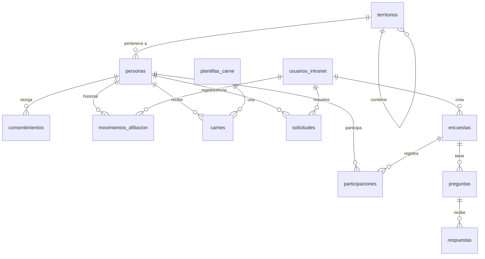

# 02 · Modelo de datos

El esquema ejecutable está en [`apps/api/src/schema.sql`](../apps/api/src/schema.sql). Este documento explica las decisiones.

## Tablas

| Tabla | Qué guarda |
|---|---|
| `territorios` | 19 territorios precargados (17 comunidades y Ceuta y Melilla). `padre_id` permite añadir provincias y municipios |
| `personas` | Simpatizantes y afiliados en la misma tabla. Cambian `tipo` y `estado` |
| `consentimientos` | Qué aceptó cada persona, con qué versión de texto y cuándo |
| `usuarios_intranet` | Equipo con rol. Los afiliados **no** están aquí |
| `movimientos_afiliacion` | Historial inmutable: inscripción, alta, cambio de tipo o territorio, suspensión, reactivación, baja, rechazo |
| `plantillas_carne` | Plantillas PDF, generales o por territorio |
| `carnes` | Carnés emitidos con versión, caducidad y revocación |
| `solicitudes` | Peticiones de la persona desde el portal y su resolución |
| `encuestas`, `preguntas` | Definición de encuestas |
| `participaciones` | Quién participó en cada encuesta, para impedir doble respuesta |
| `respuestas` | Qué se respondió |
| `sesiones` | Sesiones de persona y de equipo |
| `auditoria` | Acciones del equipo sobre datos |
| `correos` | Registro de correos enviados |

## Estados de una persona

`pendiente` → `activo` → `suspendido` ↔ `activo` → `baja`. Desde `pendiente` también se puede pasar a `rechazado`.

Cada cambio escribe una fila en `movimientos_afiliacion` con quién lo hizo, cuándo y por qué.

## Encuestas anónimas

Si una encuesta es anónima, `respuestas.persona_id` queda vacío y la lista de quién participó está en `participaciones`, sin ninguna columna que apunte a las respuestas. Así nadie puede reconstruir quién respondió qué, ni siquiera con acceso a la base de datos.

Si la encuesta es nominal (`anonima = 0`), se guarda `persona_id` en cada respuesta. Hay que avisarlo claramente a quien la responde.

> Una votación interna vinculante (por ejemplo elegir cargos) es otro problema y requiere un diseño propio: censo, secreto del voto, auditoría y encaje con los estatutos. No está en este esquema.

## Número de afiliado y código de verificación

- `numero_afiliado`: el que se imprime en el carné. Formato por decidir; propuesta `PLU-AND-000123` (siglas, territorio, secuencial).
- `codigo_verificacion`: cadena aleatoria larga que va en el QR. No se deduce del número ni de los datos de la persona.

## Datos que todavía no se guardan

- Documento de identidad (DNI/NIE): depende de si se verifica la identidad. Ver [decisiones pendientes](09-decisiones-pendientes.md).
- Cuotas y pagos.
- Votaciones internas.
