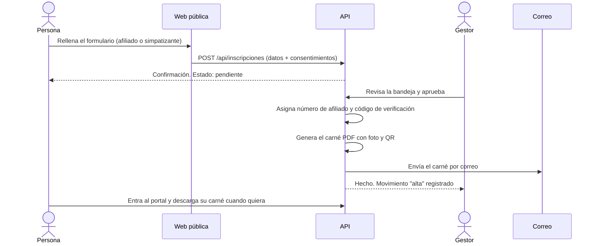

# 04 · Afiliación y carné

Es la columna vertebral del área privada. Se basa en el flujo de IDENTIA (inscripción, aprobación, carné con QR, portal y verificación).

## Flujo

## Tipos y estados

- **Simpatizante**: se apunta con datos básicos. No tiene carné.
- **Afiliado**: miembro con número de afiliado y carné.
- Una persona puede **empezar como simpatizante y pedir pasar a afiliado** (solicitud `hacerse_afiliado`).
- Estados: `pendiente`, `activo`, `suspendido`, `baja`, `rechazado`.

## Movimientos de afiliación

Cada cambio queda registrado y no se borra:

| Movimiento | Cuándo |
|---|---|
| `inscripcion` | La persona envía el formulario |
| `alta` | El gestor aprueba y la persona pasa a activa |
| `cambio_tipo` | Simpatizante a afiliado, o al revés |
| `cambio_territorio` | Cambia de territorio |
| `suspension` / `reactivacion` | Suspensión y vuelta a activo |
| `baja` | Baja voluntaria o de oficio |
| `rechazo` | Inscripción rechazada |

La persona ve su propio historial en el portal.

## Carné

### Campos de la plantilla PDF

Igual que en IDENTIA, el motor rellena **campos de formulario PDF por nombre**, no por coordenadas. Una plantilla diseñada en Illustrator y preparada en Acrobat Pro debe tener estos campos:

| Campo | Tipo | Contenido |
|---|---|---|
| `nombre` | Texto | Nombre |
| `apellidos` | Texto | Apellidos |
| `numeroAfiliado` | Texto | Número de afiliado |
| `territorio` | Texto | Territorio |
| `fechaAlta` | Texto | DD/MM/AAAA |
| `validoHasta` | Texto | DD/MM/AAAA |
| `foto` | Botón (imagen) | Foto de la persona, opcional |
| `qr` | Botón (imagen) | QR que enlaza a `/verificar/<codigo>` |

Un campo ausente se ignora sin romper el resto. Una plantilla general sirve para todos los territorios; se pueden añadir plantillas por territorio (`plantillas_carne.territorio_id`).

### Vida del carné

- Se emite al activar a un afiliado y se envía por correo.
- Se guarda cada versión en `carnes`. Reemitir crea una versión nueva y **revoca** la anterior.
- `valido_hasta` define la caducidad (duración por decidir).
- Un carné revocado o caducado aparece como no válido en `/verificar`.

### Verificación pública

`/verificar/<codigo>` responde solo **válido / no válido / caducado** y, como mucho, el nombre de pila y el territorio. Nunca teléfono, correo, dirección ni fecha de nacimiento. Los verificadores de la intranet pueden ver algo más según su rol.

### Seguridad del carné

- El QR contiene solo la URL con un código aleatorio largo.
- Se limita el número de comprobaciones por IP para evitar rastreos de códigos.
- El carné no sustituye a un documento oficial de identidad. Debe decirlo claramente.

## Ideas para después

- Carné en la cartera del móvil (Apple Wallet y Google Wallet).
- Exportación también en PNG.
- Renovación anual automática con aviso por correo.
