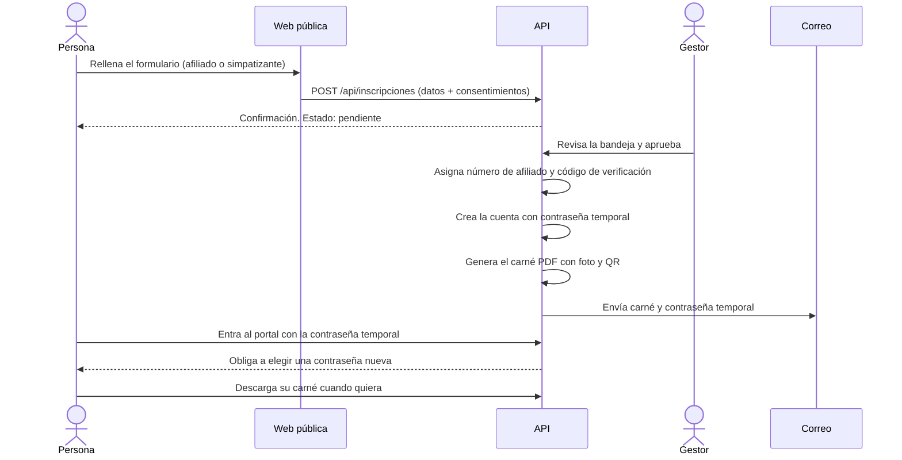

# 04 · Afiliación y carné

Es la columna vertebral del área privada. Se basa en el flujo de IDENTIA (inscripción, aprobación, carné con QR, portal y roles), con estas decisiones propias de la PLU:

- **La afiliación es gratuita.** No hay cuota. Solo hay donaciones voluntarias (ver [10 · Donaciones](10-donaciones.md)).
- **No hay verificación pública de carnés.** Solo se verifica desde la intranet, con sesión de equipo.
- **La contraseña la genera el sistema**, se envía por correo y hay que cambiarla en el primer acceso.

## Flujo



## Tipos y estados

- **Simpatizante**: se apunta con datos básicos. No tiene carné.
- **Afiliado**: miembro con número de afiliado y carné.
- Una persona puede **empezar como simpatizante y pedir pasar a afiliado** (solicitud `hacerse_afiliado`).
- Estados: `pendiente`, `activo`, `suspendido`, `baja`, `rechazado`.

## Contraseña

1. Al aprobar a una persona se crea su cuenta con una **contraseña temporal aleatoria** (12 caracteres, sin letras ambiguas como `O`, `0`, `l`, `1`).
2. Se guarda solo el hash (scrypt), nunca la contraseña. La persona la recibe por correo junto con el carné.
3. La contraseña temporal **caduca** (propuesta: 7 días) y solo sirve para el primer acceso.
4. Al entrar con ella, el portal **no deja ver nada** hasta que la persona elige una nueva (mínimo 10 caracteres y distinta de la temporal).
5. «He olvidado mi contraseña» genera otra temporal y la envía al correo de la cuenta. La respuesta de la web es siempre la misma exista o no el correo, y se limita el número de peticiones.
6. Cada cambio de contraseña cierra las demás sesiones abiertas.

Esto es lo que se pidió. Como el correo no es un canal seguro, las medidas de caducidad, un solo uso y cambio obligatorio son las que reducen el riesgo.

## Movimientos de afiliación

Cada cambio queda registrado y no se borra:

| Movimiento | Cuándo |
|---|---|
| `inscripcion` | La persona envía el formulario |
| `alta` | El gestor aprueba y la persona pasa a activa |
| `cambio_tipo` | Simpatizante a afiliado, o al revés |
| `cambio_territorio` | Cambia de territorio |
| `suspension` / `reactivacion` | Suspensión y vuelta a activo |
| `baja` | Baja voluntaria o de oficio |
| `rechazo` | Inscripción rechazada |

La persona ve su propio historial en el portal.

## Número de afiliado

Inspirado en el de IDENTIA (`A-00.000.000`: letra de control, comunidad y 6 cifras), pero más corto y sin letra:

```
09-482915
│  └──── 6 cifras aleatorias, únicas dentro del territorio
└─────── código del territorio (2 dígitos)
```

- **Territorio**: el código oficial del INE para comunidades y ciudades autónomas (01 Andalucía ... 19 Melilla). Está en `territorios.codigo_num`. Así el número ya identifica de dónde es.
- **Cifras**: aleatorias, no correlativas, para que el número no revele cuánta gente hay ni en qué orden se afilió. Se comprueba que no exista ya.
- **Capacidad**: un millón por territorio.
- En la base de datos se guarda sin guion (`09482915`) para buscar fácil; en pantalla y en el carné se muestra con guion.
- **Propuesta, pendiente de confirmar.**

Aparte, cada persona tiene un `codigo_verificacion` aleatorio largo, que es lo que lleva el QR. No se deduce del número de afiliado.

## Carné

### Campos de la plantilla PDF

Igual que en IDENTIA, el motor rellena **campos de formulario PDF por nombre**, no por coordenadas. Una plantilla diseñada en Illustrator y preparada en Acrobat Pro debe tener estos campos:

| Campo | Tipo | Contenido |
|---|---|---|
| `nombre` | Texto | Nombre |
| `apellidos` | Texto | Apellidos |
| `numeroAfiliado` | Texto | Número de afiliado, con guion |
| `territorio` | Texto | Territorio |
| `fechaAlta` | Texto | DD/MM/AAAA |
| `validoHasta` | Texto | DD/MM/AAAA |
| `foto` | Botón (imagen) | Foto de la persona, opcional |
| `qr` | Botón (imagen) | QR hacia la verificación de la intranet |

Un campo ausente se ignora sin romper el resto. Una plantilla general sirve para todos los territorios; se pueden añadir plantillas por territorio (`plantillas_carne.territorio_id`).

### Vida del carné

- Se emite al activar a un afiliado y se envía por correo.
- Se guarda cada versión en `carnes`. Reemitir crea una versión nueva y **revoca** la anterior.
- `valido_hasta` define la caducidad (duración por decidir).
- Un carné revocado o caducado aparece como no válido al verificarlo.

### Verificación (solo intranet)

No existe una página pública para comprobar carnés. La verificación se hace dentro de la intranet:

1. Un gestor o verificador inicia sesión en `/intranet`.
2. Escanea el QR del carné con el móvil o escribe el número de afiliado.
3. La pantalla muestra si el carné es **válido, caducado, revocado o inexistente**, y los datos mínimos para comprobar a la persona (nombre, número, territorio, estado y foto).
4. Cada verificación queda en `auditoria` con quién la hizo.

El QR contiene una dirección de la intranet con el código aleatorio. Quien lo escanee sin sesión de equipo solo ve la pantalla de inicio de sesión: la dirección no revela ningún dato personal.

### Seguridad del carné

- El carné no sustituye a un documento oficial de identidad. Debe decirlo claramente.
- Se limita el número de intentos de verificación por sesión.
- Los datos que ve un verificador dependen de su rol.

## Ideas para después

- Carné en la cartera del móvil (Apple Wallet y Google Wallet).
- Exportación también en PNG.
- Renovación automática con aviso por correo.
